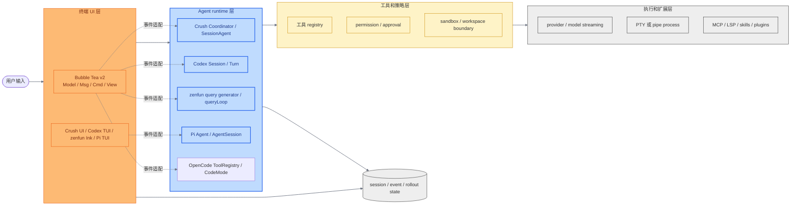
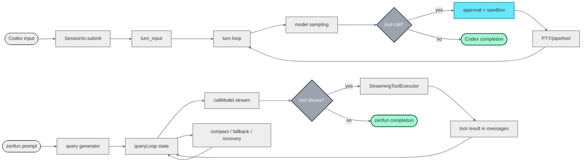
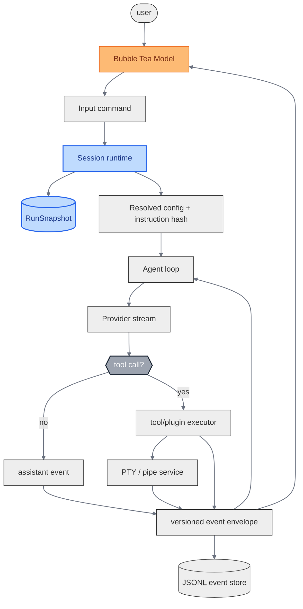
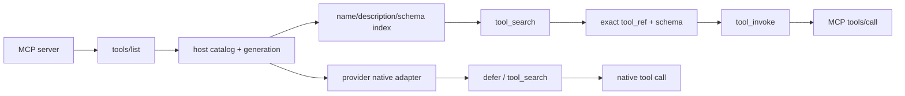

# AI Harness 源码对照报告

调研日期：2026-10-01（Asia/Singapore）

架构建议说明（2026-10-13）：本报告保留当时的源码证据和早期建议。当前产品决定、资源即时生效边界与 Day1 范围以 [PRINCIPLES.md](./PRINCIPLES.md) 和 [SPEC.md](./SPEC.md) 为准；本报告不表示这些设计已经实现。

这份报告的主证据是本地固定 checkout 的源码、目录和依赖静态分析，重点是代码结构、harness 边界、事件流和可迁移的设计。构建、测试和 CLI 冒烟只作为附录验证，不把“全量编译通过”当成调研目标。没有修改六个源码仓库的源码、配置、提交或远端状态。

## 1. 范围和固定版本

| 项目 | 本地目录 | 固定 HEAD | 解决的问题 |
| --- | --- | --- | --- |
| Codex | `.research/codex` | `7219fd735bef2f9cfd0363fecdbbb212e3df5255` | 带工作区、权限、沙箱、工具和会话运行时的 coding agent 产品 |
| Bubble Tea v2 | `.research/bubbletea` | `ff51ba4c51f85875761b15a64f9ab9aa0eaa9fa1` | Go 终端 UI 运行时：事件、命令、渲染器和终端生命周期 |
| Crush | `.research/crush` | `d59962510e4b5a71b58bdf627ad6cf095fe27524` | Charm 生态中的 Go 终端 AI 助手 |
| zenfun-code | `.research/zenfun-code` | `33bca151fc43d86f8e1c48af550fc2400c036fa9` | Claude Code 2.1.88 的结构化重建、打包 CLI 和完整 Agent 体验 |
| Pi agent | `.research/pi-agent` | `7bc154ad082e2f0029c19117a16d22a504439476` | 最小终端 coding harness：可嵌入 Agent core、多模式运行和可扩展资源 |
| OpenCode | `.research/opencode` | `97a86b7677c38e7a5a9cc2a0f6849cfb4f2ce462` | Effect/TypeScript coding agent：MCP catalog、tool registry、CodeMode 和多端产品 wiring |

`zenfun-code` 的 `cc-v2.1.88-full` 是主工程，`cc-v2.1.88` 是参考/打包工程；后者只有 `cli.js`、source map、类型声明、vendor 和包元数据，没有可直接维护的 `src` 目录。这个差异来自当前 checkout 的目录和文件清单，不是对上游发布流程的推测。

## 2. 先给结论

如果目标是一个可维护的 Go harness，最合适的组合是：

1. 用 Bubble Tea v2 做输入、状态投影和渲染；不要让 TUI 负责 Agent loop 或工具执行。
2. 用 Crush 做 Go 项目 wiring、provider、SQLite session、MCP/LSP/skills 接入的主要参考；权限服务只作为成熟项目的边界样本，不进入 day1。
3. 用 Codex 做运行时边界参考：会话提交通道、turn 状态机、approval/sandbox 分离、PTY/pipe 选择、事件和 rollout 分层。
4. 用 zenfun-code 做 Claude 风格体验参考：流式模型循环、工具结果重新进入下一轮、上下文压缩/恢复、全屏无闪烁渲染。但不要把它的 GrowthBook、远程 bridge、云端授权和 React/Ink 大型兼容层搬进第一版。
5. 用 Pi agent 做“最小 harness”参考：把 `Agent`/loop、session、资源加载、运行模式和 TUI 拆成可替换层；借鉴它的 steering/follow-up 队列、JSONL session tree 和 RPC 适配，但不直接继承其同进程 TypeScript 扩展的信任模型。
6. 用 OpenCode 做大规模工具发现参考：MCP 不必平铺到模型上下文，可以通过 CodeMode 的受限 `execute`、命名空间 catalog 和 `$codemode.search` 渐进暴露；但 day1 先实现更简单的 `tool_search + tool_invoke`，把 CodeMode 的受限解释器留作后续优化。

第一版 harness 的核心应只有一个本地会话运行时：`workspace + config + agent loop + tool registry + process/PTY + event store + Bubble Tea adapter`。插件先采用宿主控制的 JSON-RPC over stdio；day1 不引入独立 permission manager 和 sandbox。

## 3. 图表导航

- 图 1：六个项目的职责和数据流总览。
- 图 2：Bubble Tea v2 与 PTY 的具体连接方式。
- 图 3：Crush 的启动 wiring、会话、provider、权限和扩展边界。
- 图 4：Codex 与 zenfun-code 的 Agent loop、PTY、策略和持久化对照。
- 图 5：建议的最小 Go harness、插件协议、配置层、快照和事件模型。

## 4. 总体架构

图 1 把六个项目放在同一条责任链上。Bubble Tea 只占 UI 层；其他五个项目都包含更完整的 Agent runtime，但实现语言、边界和产品规模不同。



图 1 中的代码落点如下：

- Bubble Tea 的 `Model` 只有 `Init`, `Update`, `View`；`Cmd` 是返回一个异步消息的函数，见 `bubbletea/tea.go:48-65,391-398`。
- Crush 从 `cmd/root.go` 建 workspace/session/db/app/UI，再由 `app.Subscribe` 把后端事件转成 `tea.Msg`，见 `crush/internal/cmd/root.go:110-154,257-341`、`crush/internal/app/app.go:830-861`。
- Codex 把 TUI 的每会话状态与 Agent 分开；`ChatWidget` 把按键转成 `Op`/`AppEvent`，不运行 Agent，见 `codex-rs/tui/src/chatwidget.rs:502-513`。
- zenfun 的 `queryLoop` 是运行时，REPL 通过 `for await` 消费它的事件，见 `zenfun-code/cc-v2.1.88-full/src/query.ts:219-307`、`src/screens/REPL.tsx:2805-2815`。
- Pi 的 `Agent`/`agentLoop` 负责循环和 tool event，`AgentSession` 负责产品级持久化、扩展和 compaction，interactive/print/RPC 只负责各自 I/O，见 `pi-agent/packages/agent/src/agent.ts:160-231`、`packages/agent/src/agent-loop.ts:155-269`、`packages/coding-agent/src/core/agent-session.ts:1-14`、`packages/coding-agent/src/main.ts:742-784`。
- OpenCode 的当前 `dev` checkout 把 canonical tool registry、MCP catalog 和 CodeMode 分开：MCP host 通过 `tools/list` 缓存定义，模型侧由 `execute` 暴露受限 CodeMode catalog，见 `opencode/packages/opencode/src/mcp/index.ts:390-400,666-687`、`packages/opencode/src/tool/registry.ts:280-340`、`packages/opencode/src/tool/code-mode.ts:188-240`。

## 5. 六个项目各自解决什么问题

### 5.1 Bubble Tea v2：终端 UI 运行时

Bubble Tea 解决的是终端事件循环和渲染，不解决模型调用、工具策略、会话存储或插件协议。`Msg` 是 ultraviolet 事件，`Cmd` 封装可能阻塞的 I/O；程序事件循环接收消息、调用 `Update`、启动命令并渲染 `View`，见 `bubbletea/tea.go:48-65,708-899`。

它提供：

- 输入、窗口尺寸、鼠标、焦点、粘贴和终端能力消息。
- `tea.Batch` 并发执行命令、`tea.Sequence` 顺序执行命令，见 `bubbletea/commands.go:7-54`。
- alt screen、renderer、TTY 输入 reader、signal/shutdown 和测试用的输入输出注入。
- `tea.ExecProcess` 在运行一个交互式外部程序前释放终端，程序结束后恢复终端，见 `bubbletea/exec.go:15-52,101-129`。

不要把 Agent state 放到 `View`，也不要在 `Update` 中直接读文件、读 PTY 或调用模型。Crush 的 UI 指南明确要求 `Update` 不做 I/O，把工作放入 `tea.Cmd`；根 UI 模型是 Bubble Tea 唯一模型，见 `crush/internal/ui/AGENTS.md`。

### 5.2 Crush：最接近 Go harness 的完整样本

Crush 是 Go 终端 AI 助手，主流程清楚地分成四层：

1. `cmd/root.go` 解析 CLI、建立 workspace、加载 config、初始化 SQLite、skills 和 app，然后建立 Bubble Tea program。
2. `app.App` 持有 session/message/history/permission、Coordinator、LSP、skills、MCP event broker 和 run completion broker，见 `crush/internal/app/app.go:55-91`。
3. `agent.Coordinator` 选择模型、构造 tools、维护 active agent 并调用 `SessionAgent.Run`，见 `crush/internal/agent/coordinator.go:119-189,288-426`。
4. `SessionAgent` 创建 Fantasy agent，流式处理 reasoning/text/tool input/tool result/step finish，并把消息和 usage 保存到 session，见 `crush/internal/agent/agent.go:605-824,826-1121`。

扩展和边界：

- 多 provider 由 Coordinator 的模型构造和配置层负责，而不是 UI；provider/model 配置见 `crush/internal/config/config.go:92-157`，构造见 `coordinator.go:967-...`。
- 权限由独立 `permission.Service` 负责。请求会先处理 skip/allowlist/Hook/auto-approve，再发布请求并等待 grant/deny，见 `crush/internal/permission/permission.go:65-110,181-295`。
- MCP 初始化有状态机和 10 秒初始化预算，见 `crush/internal/agent/tools/mcp/init.go:148-207,332-421`。
- skills 是 workspace-scoped manager；内置和配置路径被发现、去重、排序，user skill 可以覆盖同名 builtin，见 `crush/internal/skills/manager.go:13-38,165-225`、`skills.go:218-408`。
- SQLite 由 `db.Connect` 统一建立，限制单连接、执行 goose migration、按 data dir 管理 `crush.db`，见 `crush/internal/db/connect.go:78-203`。
- UI 通过 app 的 pubsub 订阅 session/message/permission/question/MCP/LSP 等事件，再发送给 `tea.Program`，见 `crush/internal/ui/model/ui.go:823-1140`、`app.go:830-861`。

Crush 的主要代价是范围太大：local/client-server 双模式、全局 MCP broker、shell 配置脚本、SQLite migration、LSP、skills、hook 和多种 UI 状态都不是第一版 harness 必需项。

### 5.3 Codex：运行时边界、沙箱和长任务模型

Codex 的强项不是 Go 结构，而是把 Agent 产品中的运行时边界定义得很清楚。

- `CodexThread` 持有 session、I/O、residency gate、source、startup metadata 和 rollout path；外部通过 `submit` 投递 `Op`，见 `codex-rs/core/src/codex_thread.rs:86-112,201-213,251-253`。
- `SessionIo` 用有界异步 channel 把提交包装成带唯一 ID/trace 的 `Submission`；session loop 再按 `Op` 分派，见 `codex-rs/core/src/session/mod.rs:399-415,930-1047`、`session/handlers.rs:423-493`。
- turn 支持 start、steer、interrupt、recover、compact 和继续执行；每一轮会采样、运行工具、继续采样，见 `session/turn_input.rs:299-396`、`session/turn.rs:149-170,430-735`。
- `ThreadConfigSnapshot` 把 model/provider、approval policy、permission profile、workspace roots、session source、collaboration mode 等放进运行快照，见 `codex_thread.rs:86-112`。
- approval 和 sandbox 是两层策略：`ExecApprovalRequirement` 区分 Skip/NeedsApproval/Forbidden，approval cache 只缓存会话内批准；工具 approval 还覆盖 MCP call、network、apply patch 和 stdin，见 `tools/sandboxing.rs:40-116,151-230`、`tools/approvals.rs:70-156,478-550`。
- app-server 根据是否需要 TTY 选择 PTY、pipe stdin 或无 stdin pipe，并支持增量输出、stdin 写入和 resize，见 `codex-rs/app-server/src/command_exec.rs:231-317,600-664`。
- project instructions 会按项目根到 cwd 收集多层 `AGENTS.md`，再按 trust、字节预算和 sandbox 条件组合，见 `codex-rs/core/src/agents_md.rs:1-18,56-220`。
- rollout 使用本地 JSONL，同时由 SQLite 保存 thread metadata，见 `codex-rs/core/src/config/mod.rs:599-607`、`core/src/rollout.rs:1-46`。

Codex 不适合直接复制的部分包括 Rust async 运行时、app-server 协议、远程 session、复杂协作/插件系统和全量 sandbox 兼容矩阵。适合复制的是“提交通道—会话 loop—turn—工具策略—事件/rollout”的分层。

### 5.4 zenfun-code：Claude Code 风格体验的重建

`cc-v2.1.88-full` 的 Agent loop 是一个异步 generator：

1. `query` 创建 state，消费 `queryLoop` 的 stream/message/tombstone/tool summary，并在正常返回时发出 command lifecycle completion，见 `src/query.ts:181-239`。
2. `queryLoop` 每一轮重建上下文，执行 history snip、microcompact、context collapse 和 auto compact，见 `src/query.ts:241-549`。
3. 模型流式返回 assistant/tool blocks；`StreamingToolExecutor` 执行工具并产生 tool result，下一轮把结果放回 prompt，见 `src/query.ts:551-845`。
4. 运行时还处理 abort、fallback、prompt-too-long、max-output recovery、stop hooks 和 post-sampling hooks，见 `src/query.ts:999-1121` 及后续恢复分支。

外层 REPL 只负责用户输入、React/Ink 状态和 `query` 事件消费；它有并发 guard，防止重复 query，见 `src/screens/REPL.tsx:2878-2945`。SDK/headless 的 `QueryEngine` 复用同一 query loop，再记录 transcript 和 session storage，见 `src/QueryEngine.ts:151-178,436-460,675-730`。

它的配置、插件和策略比第一版 harness 更重：

- settings source 依次涉及 user/project/local/flag/policy；policy 还按 remote、MDM、managed file、HKCU 选择最高优先级来源，见 `src/utils/settings/constants.ts:1-118`、`src/utils/settings/settings.ts:645-735`。
- GrowthBook 会先处理环境变量覆盖、配置覆盖和 force-enable，再做远程 feature evaluation，见 `src/services/analytics/growthbook.ts:60-108,160-215,748-815`。这说明 feature gate 的最终行为可能依赖远端配置，不能当作纯本地协议。
- plugin manifest 可以声明 commands、agents、skills、hooks、output styles、MCP、LSP、settings 和 user config；内置插件用 `{name}@builtin` 标识，见 `src/types/plugin.ts:14-78`、`src/utils/plugins/schemas.ts:870-915`、`src/plugins/builtinPlugins.ts:18-97`。
- `canUseTool` 的返回路径是：权限配置/分类器先给 allow、deny 或 ask；ask 再进入 coordinator、swarm worker、交互 UI 或 bridge/channel 回调；abort 会取消等待，见 `src/hooks/useCanUseTool.tsx:27-183`。
- sandbox-adapter 是对外部 `@anthropic-ai/sandbox-runtime` 的适配层，并把 Claude 的路径语义、managed domain/read path 和 settings source 转成 sandbox config，见 `src/utils/sandbox/sandbox-adapter.ts:1-18,84-150`。

### 5.5 zenfun-code 的无闪烁 TUI

仓库内的 `tui-no-flicker-deep-dive.md` 是机制说明；源码证据是：

- `AlternateScreen` mount 时发送进入 alt screen、清屏、归位和鼠标 tracking；unmount 时关闭 tracking、退出 alt screen，并通知 Ink 实例，见 `src/ink/components/AlternateScreen.tsx:13-78`。
- `FullscreenLayout` 在全屏模式使用 sticky `ScrollBox` 固定底部输入区；是否启用由 `CLAUDE_CODE_NO_FLICKER` 决定，见 `src/components/FullscreenLayout.tsx:258-268,338-368`。
- renderer 使用 front/back frame 和 cell screen buffer；alt screen 使 buffer 高度对应 terminal rows，见 `src/ink/renderer.ts:15-27,35-46,84-100`。
- `log-update` 对 TTY 做前后帧 diff；alt screen 下可以用 DECSTBM 硬件滚动并同步修改前一帧 buffer，只有滚入的新行继续进入 diff，见 `src/ink/log-update.ts:123-185`。
- 在内容涉及主屏幕 scrollback 时，代码仍会走标注为 `fullResetSequence_CAUSES_FLICKER` 的恢复路径；无闪烁不是“任何情况下绝不全量重绘”，而是把正常 fullscreen 路径保持在可局部更新的 alt screen 内，见 `src/ink/log-update.ts:187-246`。

这套设计可以给 Go harness 两个明确约束：全屏聊天应使用 alt screen 和自有滚动状态；PTY 输出不能直接写到与 Bubble Tea renderer 相同的 stdout，否则两套 renderer 会互相破坏屏幕状态。

### 5.6 Pi agent：最小 harness 的分层样本

Pi 的定位不是“把所有 coding agent 功能都内置”，而是给一个可改造的最小终端 harness。`packages/coding-agent/README.md:20-24` 明确把它描述为 minimal terminal coding harness，并把 interactive、print/JSON、RPC 和 SDK 分成四种使用方式；默认只给模型 `read`、`write`、`edit`、`bash` 四个工具，更多能力通过 extensions、skills、prompt templates、themes 和 packages 加入，见 `README.md:96,316-388`。

它的结构比表面上的 CLI 更值得借鉴：

- `packages/agent` 是可独立复用的 Agent core。`Agent` 保存 transcript、streaming state、pending tool calls 和 abort 状态，订阅者按顺序接收事件，见 `packages/agent/src/agent.ts:160-231,294-364`。
- `agentLoop` 把事件流、turn、工具 follow-up、steering 和 follow-up queue 明确分开。一个外层循环接收 follow-up，一个内层循环处理 tool calls 和 steering；`prepareNextTurn` 允许在下一次 provider request 前替换 context/model/thinking level，见 `packages/agent/src/agent-loop.ts:155-269`、`packages/agent/src/types.ts:135-276`。
- 工具边界很窄且可拦截：参数先 schema validate，再进入 `beforeToolCall`；执行过程可发 `tool_execution_update`，完成后由 `afterToolCall` 修改结果或终止 batch，见 `packages/agent/src/agent-loop.ts:373-515,562-742`。
- `AgentMessage` 可以声明合并自定义消息，但只在 `convertToLlm` 边界转成 provider 能理解的 `Message[]`；UI-only/custom message 不必污染 LLM transcript，见 `packages/agent/src/types.ts:286-309,135-186`。
- `packages/agent/src/harness` 在 core 之上提供 `AgentHarness`：每个 turn 重新建立 session context、资源、system prompt、active tools 和 provider options，再把 hook/event/pending session writes 串起来，见 `agent-harness.ts:174-223,331-469,484-537`。这给 Go harness 一个清晰的“低层 loop + 产品 harness”分界。
- session 默认是 append-only JSONL tree，而不是数据库表：entry 通过 `id`/`parentId` 形成树，leaf 指向当前分支；compaction、branch summary、model/tool change、custom entry 都是显式 entry，见 `harness/types.ts:334-478`、`harness/session/session.ts:22-80,82-265`、`harness/session/jsonl-storage.ts:59-212,226-293`。这使 `/tree`、fork、clone 和恢复都建立在同一份事实记录上。
- `coding-agent` 再加产品服务边界：`AgentSession` 被所有模式复用，拥有 session persistence、model/thinking、compaction、bash、branching 和 extension hooks，见 `packages/coding-agent/src/core/agent-session.ts:1-14,122-186,322-347`；`AgentSessionRuntime` 在切换/new/fork session 时先 teardown，再按新的 cwd 重建服务，见 `agent-session-runtime.ts:61-244`。
- 启动层先解析最终 session cwd，再创建 auth、settings、model registry 和 resource loader；extension provider registration、skills、prompt templates、themes 和 `AGENTS.md`/`CLAUDE.md` 都在资源装配阶段完成，见 `main.ts:545-614`、`agent-session-services.ts:62-200`、`resource-loader.ts:75-150`。
- 运行模式是薄适配器：print mode 只调用 `session.prompt` 并输出最终文本或 JSON events，RPC mode 用 JSON Lines 接收 command、返回 response、转发 session events，见 `modes/print-mode.ts:28-157`、`modes/rpc/rpc-mode.ts:1-12,49-129`、`modes/rpc/rpc-types.ts:19-104`；interactive mode 的文件头直接写明“delegating business logic to AgentSession”，见 `modes/interactive/interactive-mode.ts:1-4`。
- `pi-tui` 自己维护 input、focus、overlay、previous frame 和 differential rendering；它不是 Agent core 的一部分，见 `packages/tui/src/tui.ts:236-278,441-597,953-1077`。它的 bash/extension `exec` 是普通 `spawn` + pipe，带 timeout/abort，并不等于 coding agent 已经提供了一个通用 PTY service，见 `packages/coding-agent/src/core/exec.ts:1-45`。

Pi 的取舍也很明确：核心不内置 sub-agent 和 plan mode，而是让扩展或 package 提供；扩展是同进程 TypeScript module，README 还明确警告 package 拥有完整系统访问权，见 `packages/coding-agent/README.md:20-24,346-388`。因此它适合借鉴模块拆分和运行模式，不适合直接作为 Go harness 的权限边界。

### 5.7 OpenCode：把大工具集变成可搜索的受限执行面

OpenCode 当前 `dev` checkout 的 CodeMode 不是一个普通 MCP tool wrapper，而是一个独立的工具编排层：模型只看到一个 `execute` tool；`execute` 的输入是受限 JavaScript，程序内部通过命名空间调用 host 提供的 schema-backed tools。设计目标是减少大 catalog 占用、避免依赖链每一步都回到模型、让中间结果留在程序内，见 `opencode/packages/codemode/codemode.md:12-38`。

它的发现机制有三层：

- `CodeMode.prepare` 对 catalog 做 token budget，保留每个 namespace 的可见性，再把完整签名按 namespace round-robin 放进 system description，见 `opencode/packages/codemode/src/tool-runtime.ts:484-545`。
- catalog 不完整时，模型使用保留的 `$codemode.search`；搜索索引同时覆盖 path、description、input property name/description，结果带可直接复制的完整 TypeScript signature，并支持 exact lookup、namespace 和分页，见 `tool-runtime.ts:76-105,342-474,563-601`。
- V2 adapter 把 MCP tools 分组进 server namespace，通过 `CodeModeTool` 的内部 interpreter 调用 MCP；外层只有一个 `execute` invocation，子调用的状态作为 metadata 给 TUI，见 `packages/opencode/src/tool/code-mode.ts:188-305`。

这对我们的启发是“默认不展开”可以比简单地隐藏 schema 更强：模型拿到的是一个可搜索的 capability catalog，搜索后得到准确签名，再在受控执行通道内完成调用。但 OpenCode 的 interpreter、schema boundary、并发预算和 nested metadata 都是第二阶段复杂度；day1 应先做 `tool_search + tool_invoke`，不先实现完整 CodeMode。

## 6. 职责对照

| 责任 | Bubble Tea v2 | Crush | Codex | zenfun-code | Pi agent | OpenCode |
| --- | --- | --- | --- | --- | --- |
| Agent loop | 无 | `Coordinator` + `SessionAgent` + Fantasy stream | `Session` + `turn` + provider sampling | `queryLoop` async generator | `Agent`/`agentLoop` + tool follow-up/steering queue |
| 模型/provider | 无 | config/provider/model abstraction | core model client、MCP/plugin context | `deps.callModel`、fallback model、Anthropic API/bootstrap | 独立 `pi-ai` stream；`ModelRegistry`/auth 由 coding-agent 装配 |
| PTY/命令 | `ExecProcess` 只负责临时释放/恢复终端 | 工具/后台 shell 由 app/agent 工具层管理 | app-server 明确选择 PTY/pipe 并支持 write/resize | Bash/PowerShell/tool services；外部 sandbox runtime；不是 Ink renderer 的职责 | `spawn`/pipe 的 exec 和 bash streaming；没有通用 core PTY service |
| TUI | 事件循环和 renderer | 单一 Bubble Tea model + Ultraviolet | TUI 反映 core 状态，发送 `Op` | React/Ink reconciler、Yoga、screen buffer、diff、fullscreen layout | 独立 `pi-tui`：组件、输入、overlay、差分渲染 |
| 配置 | program options | global/workspace/project config + shell config | ConfigBuilder、多层 TOML、AGENTS | user/project/local/flag/policy + remote feature gates | global `~/.pi/agent` + project `.pi` settings，资源路径可扩展 |
| 工具发现 | 无 | MCP 初始化后注册工具 | `ToolExposure::Deferred` + BM25 `tool_search` | MCP/tool registry 以语义工具为主 | 工具集通常直接随 session 暴露 | token-budget catalog + `$codemode.search` + CodeMode namespaces |
| 工具/插件 | 无 | tools、MCP、LSP、skills、hooks | MCP、plugins、dynamic tools、extensions | plugin manifest、MCP、LSP、skills、hooks、remote bridge | TS extensions、skills、prompt templates、themes、packages |
| 权限 | 无 | Permission Service、allowlist、grant/deny、yolo | approval policy、sandbox、approval cache、network/MCP approval | `canUseTool`、permission mode、classifier、Hook、sandbox adapter、bridge | core hook 可 block；宿主 sandbox/approval 不是默认一等边界，扩展拥有进程权限 |
| 持久化 | 无 | SQLite sessions/messages/files + pubsub | JSONL rollout + SQLite thread metadata | `~/.claude/projects/.../<session>.jsonl`、history JSONL、QueryEngine flush | append-only JSONL session tree；也有 in-memory/no-session |

## 7. 可以迁移到 Go harness 的设计

### 7.1 最小核心模块

```text
cmd/
  main.go                 CLI、--help、--version、一次性/交互模式
workspace/
  root.go                 cwd、项目根、AGENTS/CLAUDE 类指令发现
config/
  layers.go               分层加载、来源和配置 hash
session/
  session.go              session/run/turn 状态和取消
agent/
  loop.go                 model -> tool calls -> tool results -> next turn
provider/
  stream.go               provider 抽象、增量 token、fallback
tool/
  registry.go             工具描述、参数校验、执行器
process/
  pty.go                  PTY/pipe、stdin、resize、exit
events/
  event.go                版本化事件、订阅、seq
store/
  snapshot.go             append-only event/JSONL 或 SQLite snapshot
plugin/
  protocol.go             JSON-RPC stdio、manifest、capability
resource/
  snapshot.go             配置、prompt、tool/plugin registry 的 generation snapshot
protocol/
  command.go              TUI、桌面端、CLI 到 runtime 的 command adapter
ui/
  model.go                Bubble Tea Model、消息适配和 View
```

模块边界：

- `agent` 不导入 Bubble Tea；它只发布 domain event，并接受 user input、PTY input、resize、cancel。
- `ui` 不直接调用 provider、shell 或数据库；它把用户动作转成 command/event。
- `protocol` 只负责把不同入口转换成同一组 command/event，不把 TUI 或桌面端的布局对象传进 runtime。
- `resource` 在 run 边界生成不可变 snapshot；热加载先构造新 generation，再原子替换，当前 run 继续使用旧 snapshot。
- `process` 是唯一拥有 PTY handle 的模块；UI 只消费 `PTYOutput`/`PTYExited` 事件。
- `store` 保存可恢复状态和 transcript；实时 UI 状态可以从事件投影，不要求每个 token 都写 SQLite。

Pi 的拆分说明 `agent` 还可以继续细分：低层 loop 只处理模型、tool 和事件；产品 harness 再处理 session、resource、compaction 和模式适配。Go 版不必复制 Pi 的 TypeScript 包布局，但应保留这个依赖方向：`ui -> runtime events`，而不是 `ui -> provider/tool`。

### 7.2 第一版插件协议

第一版采用 JSON-RPC 2.0 over stdio，插件作为子进程运行。这样可以先支持 Go、Node、Python，不引入远程服务发现和复杂的 marketplace。

Manifest 最小字段：

```json
{
  "protocol": 1,
  "id": "acme.formatter",
  "version": "0.1.0",
  "entry": ["node", "plugin.js"],
  "capabilities": {
    "tools": [{"name": "format", "inputSchema": {"type": "object"}}],
    "events": ["progress"]
  }
}
```

协议方法：

| 方法 | 作用 | 宿主约束 |
| --- | --- | --- |
| `initialize` | 协商 protocol、workspace、环境和 host capabilities | 宿主不发送 secrets，确认可用的 host capabilities |
| `list_tools` | 返回工具名、版本和 JSON Schema | 宿主验证 name 唯一性和 schema 大小 |
| `call_tool` | 传入 `run_id`、`tool_call_id`、参数 | 支持 deadline/cancel，并把结果映射为统一事件 |
| `cancel` | 取消未完成调用 | 宿主仍等待进程退出/回收 |
| `shutdown` | 有序关闭 | 超时后由 host kill 子进程 |

插件返回中必须区分 `result`、`error`、`progress`；宿主把它们转换成统一事件。插件可以声明能力，但不能改变事件 envelope、取消和进程回收语义。

第一版不做：远程 marketplace、自动 git/npm/pip 安装、插件间依赖、插件直接注入 system prompt。先把本地协议、取消和崩溃回收稳定下来。

### 7.3 配置层级

建议使用显式来源而不是隐式 map 覆盖：

```text
defaults
  < user (~/.config/harness/config.json)
  < project (<repo>/.harness/config.json)
  < local (<repo>/.harness/config.local.json, gitignored)
  < environment (只允许非 secret 的覆盖或 secret 引用)
  < CLI flags
  < session/run overrides
```

session/run override 只覆盖本次运行的模型、prompt、cwd 等运行参数；secret 只接受环境变量名、外部 keyring/vault 引用或运行时注入，不能写进 config、snapshot、event 或 report。

这个顺序吸收了 Crush 的 global/workspace 搜索和 zenfun 的 user/project/local/flag 分层，同时避免把 zenfun 的远程 policy、MDM 和 GrowthBook 实现整个搬进本地 harness。

### 7.4 运行快照

`RunSnapshot` 至少包含：

```text
schema_version
session_id / run_id / turn_id
workspace_root / cwd
model / provider / fallback_model
config_hash / instruction_hash
plugin_manifest_hash / tool_manifest_hash
resource_generation / resource_hash
status: queued | running | waiting_pty | completed | failed | cancelled
active_tool_call_id
pty: pid, cols, rows, stdin_open, exit_code
last_event_seq / last_persisted_at
error_code / error_message_without_secret
```

快照记录“启动时采用了什么”，不是每个 token 的日志。配置、指令、tool/plugin manifest 在 run 开始时解析并 hash；运行中配置刷新只影响下一次 run。这个做法对应 Codex 的 `ThreadConfigSnapshot`，也避免 Crush/zenfun 中大量实时 UI 状态和 backend state 互相覆盖。

### 7.5 事件模型

事件使用统一 envelope：

```json
{
  "schema_version": 1,
  "event_id": "uuid",
  "session_id": "uuid",
  "run_id": "uuid",
  "seq": 42,
  "type": "tool.requested",
  "ts": "2026-09-30T00:00:00Z",
  "payload": {}
}
```

第一版事件类型：

```text
run.started
user.input_accepted
model.request_started
model.delta
model.request_finished
tool.requested
tool.progress
tool.result
pty.started
pty.output
pty.resized
pty.exited
context.compacted
resource.reloaded
run.completed
run.failed
run.cancelled
```

事件的实时订阅给 Bubble Tea 和桌面端；append-only JSONL 是第一版足够的恢复介质，session 索引、查询和并发写入稳定后再加 SQLite。`seq` 由 session 内单调递增，UI 重连时从 `last_event_seq` 补发；同一 `tool_call_id`、`pty_id` 用于幂等和关联。第一版不产生 approval 事件。

## 8. Bubble Tea v2 与 PTY 的具体连接

```mermaid
flowchart LR
  K([键盘 / 窗口尺寸]) --> B[Bubble Tea input reader]
  B --> M[Update(msg)<br/>只改 UI 状态]
  M --> C1[Cmd: write stdin / resize PTY]
  C1 --> P[PTY process service]
  P --> O[reader goroutine]
  O --> S[program.Send(ptyMsg)]
  S --> M
  M --> V[View() -> tea.View]
  V --> R[Bubble Tea renderer]
  R --> T[(terminal stdout)]
  P --> E[ptyExitMsg / errorMsg]
  E --> M
  A[/interactive child app/] -.->|需要完整终端控制权| X[tea.ExecProcess]
  X --> P

  classDef baseline fill:#eee,stroke:#333,stroke-width:1px
  classDef poly fill:#bfdbfe,stroke:#2563eb,stroke-width:2px,color:#1e3a8a
  classDef keyNode fill:#fca5a5,stroke:#7f1d1d,stroke-width:3px,color:#450a0a
  classDef immune fill:#fee2e2,stroke:#dc2626,stroke-width:1px
  classDef stageBg fill:#fef3c7,stroke:#ca8a04,stroke-width:1px
  classDef hook fill:#fde047,stroke:#ca8a04,stroke-width:1px,color:#422006
  classDef tuiLayer fill:#fdba74,stroke:#ea580c,stroke-width:1px,color:#7c2d12
  classDef autoMode fill:#93c5fd,stroke:#2563eb,stroke-width:2px,color:#1e3a8a
  classDef planMode fill:#c4b5fd,stroke:#7c3aed,stroke-width:2px,color:#2e1065
  classDef bypass fill:#fca5a5,stroke:#dc2626,stroke-width:2px
  classDef sandbox fill:#67e8f9,stroke:#0891b2,stroke-width:2px
  classDef acceptEditsNode fill:#a7f3d0,stroke:#059669,stroke-width:2px,color:#064e3b
  classDef denyTerm fill:#fca5a5,stroke:#991b1b,stroke-width:2px,color:#7f1d1d
  classDef askTerm fill:#fdba74,stroke:#9a3412,stroke-width:2px,color:#7c2d12
  classDef allowTerm fill:#a7f3d0,stroke:#065f46,stroke-width:2px,color:#064e3b
  classDef passthrough fill:#e0e7ff,stroke:#4338ca,stroke-width:2px,stroke-dasharray:4 2,color:#312e81
  classDef virtualUI fill:#fff,stroke:#6b7280,stroke-width:2px,stroke-dasharray:5 5,color:#374151
  classDef deadCode fill:#f3f4f6,stroke:#9ca3af,stroke-width:1px,stroke-dasharray:5 5,color:#6b7280
  classDef abort fill:#7f1d1d,stroke:#450a0a,stroke-width:3px,color:#fff
  classDef decision fill:#9ca3af,stroke:#1f2937,stroke-width:2px,color:#fff
  linkStyle default stroke:#6b7280,stroke-width:1.5px
  class B,M,V,R tuiLayer
  class P,O,C1,E baseline
  class A,X virtualUI
```

推荐实现：

1. `process.PTY` 用 `os/exec` 加平台 PTY adapter 启动命令；reader goroutine 读取 bytes，按 chunk 发布 `PTYOutput` domain event。
2. app 层把 domain event 转成 `ptyOutputMsg`，调用 `program.Send`；Bubble Tea 的 event loop 会在自己的 goroutine 中调用 `Update`，UI model 只追加 buffer、更新 cursor/scroll state。
3. 输入框的 `Update` 返回一个 `tea.Cmd`，由 command 写入 PTY stdin；不要在 `Update` 内直接阻塞写入。
4. 窗口大小消息返回 resize command，调用 PTY 的 `SetWinsize`；PTY 退出返回 exit message，统一结束 tool call 和 run。
5. 需要运行 vim、shell、top 这类自己接管终端的程序时，使用 `tea.ExecProcess` 的 release/restore 生命周期；不能让子程序和 Bubble Tea renderer 同时写同一个终端。
6. 测试用 `WithInput`、`WithOutput`、`WithWindowSize` 或 fake PTY 注入 bytes，验证 `Msg -> Update -> Cmd -> Msg`，不启动真实模型和真实终端。Bubble Tea 自己的 screen test 使用 `NewProgram`、bytes input/output 和固定窗口尺寸，见 `bubbletea/screen_test.go:61-159`。

## 9. Crush 的启动、会话和扩展细节

```mermaid
flowchart LR
  C([crush CLI]) --> W[setupWorkspace]
  W --> CFG[config.Init<br/>global + project layers]
  W --> DB[(crush.db + migrations)]
  W --> SK[skills discovery]
  CFG --> APP[app.New]
  DB --> APP
  SK --> APP
  APP --> CO[Coordinator]
  CO --> AG[SessionAgent.Run]
  AG --> PR[provider stream]
  AG --> TL[tool registry]
  TL --> PM{{permission.Service}}
  PM -->|allow| EX[execute tool]
  PM -->|ask| AQ[/UI approval/]
  PM -->|deny| DN[return denied tool result]
  EX --> MCP[MCP / LSP / shell / file tools]
  APP --> UI[tea.NewProgram + Subscribe]
  UI --> EV[session/message/permission events]
  EV --> UI

  classDef baseline fill:#eee,stroke:#333,stroke-width:1px
  classDef poly fill:#bfdbfe,stroke:#2563eb,stroke-width:2px,color:#1e3a8a
  classDef keyNode fill:#fca5a5,stroke:#7f1d1d,stroke-width:3px,color:#450a0a
  classDef immune fill:#fee2e2,stroke:#dc2626,stroke-width:1px
  classDef stageBg fill:#fef3c7,stroke:#ca8a04,stroke-width:1px
  classDef hook fill:#fde047,stroke:#ca8a04,stroke-width:1px,color:#422006
  classDef tuiLayer fill:#fdba74,stroke:#ea580c,stroke-width:1px,color:#7c2d12
  classDef autoMode fill:#93c5fd,stroke:#2563eb,stroke-width:2px,color:#1e3a8a
  classDef planMode fill:#c4b5fd,stroke:#7c3aed,stroke-width:2px,color:#2e1065
  classDef bypass fill:#fca5a5,stroke:#dc2626,stroke-width:2px
  classDef sandbox fill:#67e8f9,stroke:#0891b2,stroke-width:2px
  classDef acceptEditsNode fill:#a7f3d0,stroke:#059669,stroke-width:2px,color:#064e3b
  classDef denyTerm fill:#fca5a5,stroke:#991b1b,stroke-width:2px,color:#7f1d1d
  classDef askTerm fill:#fdba74,stroke:#9a3412,stroke-width:2px,color:#7c2d12
  classDef allowTerm fill:#a7f3d0,stroke:#065f46,stroke-width:2px,color:#064e3b
  classDef passthrough fill:#e0e7ff,stroke:#4338ca,stroke-width:2px,stroke-dasharray:4 2,color:#312e81
  classDef virtualUI fill:#fff,stroke:#6b7280,stroke-width:2px,stroke-dasharray:5 5,color:#374151
  classDef deadCode fill:#f3f4f6,stroke:#9ca3af,stroke-width:1px,stroke-dasharray:5 5,color:#6b7280
  classDef abort fill:#7f1d1d,stroke:#450a0a,stroke-width:3px,color:#fff
  classDef decision fill:#9ca3af,stroke:#1f2937,stroke-width:2px,color:#fff
  linkStyle default stroke:#6b7280,stroke-width:1.5px
  class C,W,CFG,DB,SK,APP,CO,AG,PR,TL,EX,MCP,EV baseline
  class UI,AQ tuiLayer
  class PM keyNode
  class DN denyTerm
```



Crush 的实际 wiring 在 `internal/cmd/root.go:110-154,257-341`；`app.New` 把服务和 event broker 组合在 `internal/app/app.go:93-201`；Coordinator 的一次 run 在 `internal/agent/coordinator.go:298-426`；UI 订阅在 `internal/app/app.go:830-861`。图 3 的关键取舍是：Coordinator 不应该成为 UI model，permission 也不应该散落在每个 tool 中。

## 10. Codex 与 zenfun-code 的 loop 对照



Codex 的 submit/session/turn 链位于 `codex-rs/core/src/session/mod.rs:954-1047`、`session/turn_input.rs:299-396` 和 `session/turn.rs:430-735`；zenfun 的 generator、模型流和工具 follow-up 位于 `cc-v2.1.88-full/src/query.ts:219-239,551-845`。Codex 把长任务控制、steer、recover 和 approval/sandbox 明确分层；zenfun 把 compact、fallback、tool result 和 UI stream 聚合在同一个异步循环中。Go harness 应保留两者共同的状态转移，但把 compaction、approval、PTY、UI 作为独立可替换服务。

## 11. 最小 harness 的完整数据流



这条链把 UI、runtime、process、store 的拥有关系固定下来：

- UI 只发送 input/resize/PTY input/cancel，并消费 event。
- runtime 拥有 session/run/turn 和 provider loop。
- tool/plugin executor 负责调用和返回结果；取消、deadline、退出回收属于 runtime/process 生命周期。
- PTY service 发布 output/resize/exit，不能直接写 Bubble Tea 的 renderer stdout。
- event store 保存可恢复的事实；snapshot 保存一次 run 的配置和 resource generation 边界。

## 12. Crush、Codex、zenfun-code、Pi 的取舍

| 维度 | Crush | Codex | zenfun-code | Pi |
| --- | --- | --- | --- | --- |
| 与 Go 的接近程度 | 最高；Go + Bubble Tea v2 + SQLite | 最低；Rust async/runtime | 低；TypeScript/Bun/React/Ink | 结构最接近最小 harness，但实现是 TypeScript/Bun |
| 运行时边界 | 清晰，但 app/agent/UI/全局 broker 功能多 | 最清晰；session、turn、approval、sandbox、app-server 分离 | 体验完整，但大量状态和产品兼容逻辑集中在 TS 生态 | `agent core`、`AgentSession`、mode、TUI 分层清晰 |
| provider/工具 | 直接可参考 provider、tool registry、MCP/LSP | 可参考多阶段 turn 和动态工具 | 可参考 streaming executor、fallback 和工具 follow-up | `pi-ai` stream、schema tool、before/after hooks |
| 权限/隔离 | Permission Service + yolo/allowlist | approval + sandbox + network/MCP approval | canUseTool + classifier + hook + sandbox adapter | core hook 可 block，但默认不是宿主 sandbox/approval 边界 |
| 持久化 | SQLite sessions/messages/files | JSONL rollout + SQLite metadata | JSONL transcript/history，SDK 自己 flush | append-only JSONL tree；支持 branch/fork/compaction |
| 第一版采用 | Go wiring、provider、SQLite 可选 | 运行时边界和安全语义 | 交互体验和恢复策略 | core/product 分层、队列、RPC、session tree |
| 第一版放弃 | global MCP、client/server、shell config | Rust/app-server 全量复制 | 远程 bridge、GrowthBook、marketplace、Ink 重建 | Bun/TS 同进程扩展信任模型、无内建 host sandbox |

实际取舍：先实现 Crush 的 Go 结构和 Bubble Tea 适配，再吸收 Pi 的 core/product 分层和 session tree，使用 Codex 的 runtime snapshot、控制协议和 PTY 边界，最后按 zenfun 的流式 UI 需求补 compact/recovery 和 fullscreen scrolling。第一版不应以“功能数量等同 Claude Code”为目标，而应先保证一次 run 可取消、可恢复、可测试。

## 13. 哪些设计不能直接照搬

| 来源 | 不直接照搬的内容 | 原因 | 保留的原则 |
| --- | --- | --- | --- |
| Bubble Tea | 把业务逻辑塞进 Model/View；在 Update 做 I/O | 会造成阻塞、竞态和不可测的终端状态 | `Msg` 是输入，`Cmd` 是副作用，`View` 是投影 |
| Crush | global MCP state、shell config 执行、client/server 双模式、全量 SQLite service | 第一版不需要跨进程部署和多产品能力；全局 broker 难以测试 | workspace scope、Coordinator/runtime 分层 |
| Codex | Rust session/app-server、全量远程协作/插件生态 | 语言和基础设施不同，功能面会把最小 harness 变成平台 | bounded submission、turn state、PTY/pipe 分支、可替换控制协议 |
| zenfun-code | GrowthBook/remote bridge/cloud auth、React/Ink 重建层、marketplace 安装生态 | 行为依赖远端服务、feature gate 和 Claude 产品兼容性 | async stream loop、tool result follow-up、compaction/recovery、alt-screen diff |
| Pi | Bun/TypeScript 同进程扩展、package 的 full system access、把权限交给 extension hook | 进程内扩展适合快速定制，不足以作为 Go 宿主的安全边界 | core/product 分离、RPC/print/interactive 适配、JSONL tree、steering/follow-up queue |

另一个不应照搬的点是“把所有事件都当成可持久化消息”。Crush 的 message/session pubsub、Codex 的 rollout event、zenfun 的 transcript message、Pi 的 agent event 和 session tree entry 语义不同。harness 应分开：用户/模型/工具结果进入 transcript，进度、PTY chunks、UI notification 进入 event stream；只有需要恢复或审计的 event 才落盘。

## 14. 验证结果和限制

源码调研是主验证；下面的构建/测试只是已有的附录结果，不作为架构结论的前提：

- `bubbletea`: `go test ./...` 通过，`76 passed in 1 packages`。
- `crush`: `go test ./...` 完成，`3253 passed, 1 failed, 7 skipped in 79 packages`。唯一失败为 `shell` 包 `TestProcessIsolation_ZshJobControlDoesNotSuspend`，测试报告 `zsh -i -c` 在 5 秒内未完成，判断为当前执行环境的 TTY/job-control 条件导致；因此 Crush 整体不能标为全绿。
- `zenfun-code`: 已安装用户目录 Bun `1.4.2`（revision `1.4.2+744846f84`），并用 `bun install --frozen-lockfile` 安装 509 个依赖。`bun run build` 已启动，但仍因源码引用而锁文件/`package.json` 未声明的 `@anthropic-ai/bedrock-sdk`、`@anthropic-ai/vertex-sdk`、`yaml` 失败；没有擅自修改原仓库配置。
- `pi-agent`: 已拉取并核对 HEAD、目录和 AGENTS 约束；按本次“源码结构优先”的范围没有安装依赖、执行完整 build/test 或启动真实 provider。
- 参考打包 CLI：`node cc-v2.1.88/cli.js --version` 输出 `2.1.88 (Claude Code)`；`--help` 正常输出 CLI 参数和命令列表。这验证的是参考打包 artifact 的启动和参数解析，不等于 `cc-v2.1.88-full` 的源码 build 通过。
- 报告中的 5 个 Mermaid 图块已用 `rg` 检查数量和字面 `\\n`；skill 要求的 `validate_mermaid.py` 在当前 skill checkout 不存在，环境也没有 `mmdc`，所以没有完成渲染级语法验证。
- 六个 clone 的 HEAD、分支和工作树状态已核对；调研期间没有编辑仓库代码、格式化、自动修复、提交、推送、生产配置或凭据。新增的 OpenCode checkout 为 `.research/opencode`，HEAD 为 `97a86b7677c38e7a5a9cc2a0f6849cfb4f2ce462`；本次只做目录、源码和静态依赖阅读，没有执行其完整构建。

没有执行：Rust/Codex 测试、真实模型调用、MCP/LSP 服务启动、远程授权、sandbox 端到端测试、真实 PTY 交互和生产配置写入。这些超出本次允许验证范围，也不能由静态源码阅读推断为已验证。

## 15. 2026-10-01 架构决策附录

本节是当前 harness 方向的最新决策，若与前文候选设计冲突，以本节为准：

- day1 不做权限管理和 sandbox；工具与插件按宿主信任边界直接执行。
- day1 使用 alt screen、PTY，并预留 PTY 的 stdin、resize、terminate、output、exit 生命周期。
- day1 具备热加载架构，但“热加载”指配置、prompt、tool/plugin manifest 和 provider/resource registry 的 generation reload；不承诺在运行进程内替换 Go 代码。
- agent core 不知道 TUI 或桌面端。两者都消费同一个语义事件流；渲染布局可以不同，但事件顺序、内容块和工具生命周期一致。
- 支持多协议接入，但协议分层实现，不把 Anthropic/OpenAI/MCP/LSP/JSON-RPC/WebSocket/SSE 混成一个协议。

### 15.1 是否需要 IR

需要，但应是小型、内部、分层的 IR，不是试图覆盖所有生态的万能 IR。当前成熟项目都有局部协议，却没有一个可以直接复用的跨 provider、跨 tool、跨 TUI/桌面端的通用 IR：

| 层 | 解决的问题 | harness 的内部契约 |
| --- | --- | --- |
| model adapter | Anthropic/OpenAI/其他模型流的差异 | `ModelRequest`、`ModelEvent`、`ContentBlock`、usage/error |
| tool/plugin adapter | MCP、LSP、本地 tool、PTY tool 的差异 | `ToolDescriptor`、`ToolCall`、`ToolProgress`、`ToolResult` |
| host/control adapter | TUI、桌面端、CLI、RPC 客户端的差异 | `Command` 输入和 `Event` 输出 |
| renderer | 终端布局和桌面布局的差异 | 只读语义事件，不产生 provider-specific UI 对象 |

建议的 host/control IR 是两组类型：

```text
Command:
  prompt | steer | abort | resize | pty.stdin | session.* | resource.reload

Event:
  run.started | model.text_delta | model.reasoning_delta
  tool.call_started | tool.progress | tool.result
  pty.started | pty.output | pty.resized | pty.exited
  run.completed | run.failed | run.cancelled | resource.reloaded
```

每个事件 envelope 至少包含 `schema_version`、`session_id`、`run_id`、`turn_id`、单调 `seq`、`kind`、`timestamp` 和 `payload`。`payload` 使用语义内容块，不携带 ANSI、Bubble Tea component 或桌面端 widget。PTY 是例外：它应保留原始字节/编码信息，并由终端投影层决定是否运行 terminal emulator。

因此“模型输出到 TUI 和桌面端都是一样的”应定义为：两端消费同一份有序语义事件；不是强求相同的换行、宽度、颜色或像素。TUI 和桌面端可以各自选择 Markdown、富文本、代码块和 PTY 画面的布局。

### 15.2 当前多协议接入的完整度

| 项目 | 已有协议/适配 | 已有统一层 | 对本 harness 的结论 |
| --- | --- | --- | --- |
| Pi | 多 provider adapter；interactive、print/JSON、JSONL RPC、SDK | `AgentEvent` + `AgentSession`，多个入口消费同一 session | 最接近“core 与 frontend 分离”，但没有通用、版本化的跨前端 IR；也没有通用 core PTY manager |
| Codex | model/tool runtime；MCP、dynamic/extension tools；CLI/TUI 与 app-server JSON-RPC | core `EventMsg`/turn 状态；app-server 有独立 command/process protocol | runtime 边界和 PTY 控制最完整，但 wire 类型是 Codex-specific，且强绑定 approval/sandbox；只取 loop、registry、control、PTY |
| Crush | fantasy provider；MCP/LSP；TUI；REST + SSE client/server | typed pubsub、run completion、`AgentEvent`/`ToolResponse` | 产品级接入完整，但 SSE 只是单向事件传输，REST/SSE proto 不是通用 IR；工具和 event schema 偏产品化 |
| zenfun-code | Anthropic Messages 及 first-party/Bedrock/Vertex/Foundry 变体；CLI stream-json、SDK/control、remote bridge、MCP transports | `Message`/`SDKMessage`、remote/control schema、streaming tool executor | 协议面最宽，但核心仍是 Claude/Anthropic 语义，且 SDK 有未实现 stub、源码 build 还有依赖声明缺口；不适合作为通用 IR |
| Bubble Tea | `Msg`/`Cmd`/`View` 和 renderer | 只统一 UI 输入/更新/渲染 | 是 TUI adapter，不是 agent 或多协议 IR |

结论是：这些项目的“接入”分别在不同轴上完整，尚没有一个项目把 model protocol、tool protocol、host control protocol 和 renderer contract 完整合并。harness 应自己定义内部边界，然后为每个外部协议写 adapter。第一版可以实现 in-process TUI + 一个 JSON-RPC/JSONL desktop adapter；WebSocket 可复用相同消息 envelope，SSE 不应作为唯一控制协议，因为它不能自然承载 prompt、steer、PTY stdin 和 resize。

### 15.3 Codex 的核心 tool 构成

你的判断是对的：Codex 与 Claude Code 的差异不只是工具名称不同，而是能力切分和执行边界不同。

Codex 当前源码中的 tool registry 是 `ToolName -> runtime + exposure`，支持 trusted/external registration、namespace、动态工具、deferred/tool search 和 code mode；可见 tool spec 还会按 feature、model 和配置裁剪，见 [`registry.rs:287-412`](/home/zenfun/mywork/zende/.research/codex/codex-rs/core/src/tools/registry.rs:287) 和 [`spec_plan.rs:349-517`](/home/zenfun/mywork/zende/.research/codex/codex-rs/core/src/tools/spec_plan.rs:349)。因此不存在一份每次运行都完全相同的永久 tool 列表。

当前核心类别如下：

| 类别 | 代表 tool | 作用 |
| --- | --- | --- |
| execution primitive | `exec_command`、`write_stdin`、`apply_patch`、`view_image` | 执行命令、控制仍运行的进程、应用 patch、把本地图片提供给模型；shell 和交互进程是主路径，见 [`exec_command.rs:112-139`](/home/zenfun/mywork/zende/.research/codex/codex-rs/core/src/tools/handlers/unified_exec/exec_command.rs:112)、[`write_stdin.rs:34-54`](/home/zenfun/mywork/zende/.research/codex/codex-rs/core/src/tools/handlers/unified_exec/write_stdin.rs:34) |
| runtime/context control | `update_plan`、`request_user_input`、`get_context_remaining`、`new_context_window`、`current_time/clock`、`sleep`、`wait_for_environment` | 改变 run 的协作状态、请求输入、管理上下文和等待环境；按 feature 注册，见 [`spec_plan.rs:1147-1296`](/home/zenfun/mywork/zende/.research/codex/codex-rs/core/src/tools/spec_plan.rs:1147) |
| integration/discovery | `list_mcp_resources`、`list_mcp_resource_templates`、`read_mcp_resource`、`tool_search`、dynamic/extension tools、MCP tools | 接入外部资源和延迟暴露的工具；名称空间和冲突由 registry/router 处理，见 [`spec_plan.rs:1131-1144`](/home/zenfun/mywork/zende/.research/codex/codex-rs/core/src/tools/spec_plan.rs:1131) 和 [`spec_plan.rs:1433-1512`](/home/zenfun/mywork/zende/.research/codex/codex-rs/core/src/tools/spec_plan.rs:1433) |
| collaboration | `spawn_agent`、`send_message`、`followup_task`、`wait_agent`、`interrupt_agent`、`list_agents` | 多 agent 协作；v1/v2 名称和是否注册取决于协作 feature，见 [`spec_plan.rs:1298-1431`](/home/zenfun/mywork/zende/.research/codex/codex-rs/core/src/tools/spec_plan.rs:1298) |
| product/feature-specific | `request_permissions`、plugin install/list、`test_sync`、code-mode `execute`/wait | 产品能力或 feature-gated 能力；本 harness 按当前决定不引入 permissions/sandbox 类工具 |

最关键的四个执行 primitive 是：

1. `exec_command`：把 shell/process 当作高能力执行原语。
2. `write_stdin`：把长任务或交互进程拆成后续控制消息，而不是每次重新调用 shell。
3. `apply_patch`：文件修改保留一个结构化 patch 原语。
4. `view_image`：把图像输入作为独立能力。

Codex 的 loop 也是“模型返回 function call，执行后把结果送回下一次采样；模型只返回 assistant message 时结束”，见 [`turn.rs:149-163`](/home/zenfun/mywork/zende/.research/codex/codex-rs/core/src/session/turn.rs:149)。app-server 又把 command process 独立成可写、可 resize、可 terminate 的 session，并在 tty 模式下调用 PTY，见 [`command_exec.rs:270-385`](/home/zenfun/mywork/zende/.research/codex/codex-rs/app-server/src/command_exec.rs:270)。这一段非常适合 day1 PTY，但不需要连同 Codex 的 approval/sandbox 一起复制。

### 15.4 Codex 与 Claude Code/zenfun 的工具设计差异

zenfun-code 的 `Tool` 是更典型的 Claude Code 风格：每个工具携带 schema、`call`、description、read-only/destructive/concurrency、progress、permission、MCP/LSP metadata 等能力，见 [`Tool.ts:362-455`](/home/zenfun/mywork/zende/.research/zenfun-code/cc-v2.1.88-full/src/Tool.ts:362)。工具编排会把可并发的只读调用分批，把非只读调用串行化，见 [`toolOrchestration.ts:19-82`](/home/zenfun/mywork/zende/.research/zenfun-code/cc-v2.1.88-full/src/services/tools/toolOrchestration.ts:19)。这意味着 Claude Code 是“很多语义明确的一等工具”，而 Codex 更接近“少数执行原语 + registry/exposure + 动态扩展”：读取、搜索、列目录等能力经常可以通过 `exec_command` 完成，patch 另有独立 primitive。

对 Go harness 的取舍是：保留 Codex 的 registry、tool exposure、长进程控制和 PTY；是否采用 Claude Code 的 `read/search/edit` 语义工具，取决于是否要更强的 UI、并发调度和可观察性，不能把两种 tool model 混写成一套模糊接口。

### 15.5 按当前决定收敛的 day1 核心

```text
runtime/       session、run、turn、取消、事件 seq、model -> tool loop
model/         provider adapters -> Model IR
tool/          ToolDescriptor、registry、executor、tool result/progress
pty/           spawn、write、resize、terminate、output、exit
resource/      config/prompt/plugin/tool registry snapshot + hot reload
protocol/      in-process command adapter + JSON-RPC/JSONL adapter
store/         JSONL transcript + run snapshot
render/        Bubble Tea alt-screen projection；desktop projection 独立
```

热加载流程：watcher 读取变更，后台构造并校验新 `ResourceSnapshot{generation, hash, ...}`，在 turn/run 边界原子切换；正在执行的 run 固定旧 snapshot，新的 tool/plugin registry 只影响下一次调用或下一次 run。新 generation 通过 `resource.reloaded` 通知 TUI 和桌面端。外部插件进程可以按 generation 重启，不能在 active run 中偷偷改变 tool schema。

alt screen 下，Bubble Tea 负责终端 stdout 和 renderer；PTY output 先进入 `pty.output` 事件，不能直接写 renderer。若子程序需要完整接管终端，应定义显式 attach/handoff：暂停或离开 alt screen、转交 terminal、结束后恢复 renderer。普通命令的 PTY 捕获模式和全屏子程序 handoff 是两个状态，不应混在一个“写 stdout”函数里。

这个版本的安全取舍是明确的：没有权限和 sandbox，插件/工具就是受信任代码。仍必须保留 timeout、cancel、process group 回收、cwd/env、输出上限和 exit status，因为它们是运行时正确性和恢复能力，不是权限系统。

### 15.6 Codex 四个核心原语的拆分方式

Codex 不是把文件能力拆成 `read/write/edit` 三个对等工具，而是按四个不同问题拆分：

| 原语 | 它解决的问题 | 关键状态 |
| --- | --- | --- |
| `exec_command` | 在工作目录启动任意 shell/process，并返回输出；可选择 PTY | command、cwd、PTY/pipe、yield、output、process id |
| `write_stdin` | 继续操作同一个仍在运行的命令；空输入表示轮询输出 | process/session id、stdin bytes、yield、output |
| `apply_patch` | 用变更指令精确修改文本文件，而不是让模型重写整个文件 | file path、context、old lines、new lines、add/delete/move |
| `view_image` | 把本地图片转换成模型能消费的图像输入 | path、image bytes、detail、image input item |

`exec_command` 的 schema 有 `cmd`、`workdir`、`tty`、`yield_time_ms` 和 `max_output_tokens`；`tty=true` 选择 PTY，省略或为 false 使用普通 pipe，见 [`shell_spec.rs:24-114`](/home/zenfun/mywork/zende/.research/codex/codex-rs/core/src/tools/handlers/shell_spec.rs:24)。运行时启动进程、收集输出，并在进程仍存活时把它放进 `UnifiedExecProcessManager`；输出里带 process/session id，后续由 `write_stdin` 继续，见 [`process_manager.rs:448-519`](/home/zenfun/mywork/zende/.research/codex/codex-rs/core/src/unified_exec/process_manager.rs:448)。

`write_stdin` 不是“写入某个文件”的工具。它接收已有 `session_id`、要写入 stdin 的字符、等待时间和输出预算；`chars` 为空时只轮询。handler 把它转给同一个 process manager，因此长任务、REPL、需要输入的命令不会被拆成互相无关的新进程，见 [`shell_spec.rs:117-158`](/home/zenfun/mywork/zende/.research/codex/codex-rs/core/src/tools/handlers/shell_spec.rs:117) 和 [`write_stdin.rs:77-113`](/home/zenfun/mywork/zende/.research/codex/codex-rs/core/src/tools/handlers/unified_exec/write_stdin.rs:77)。

`view_image` 也不是通用文件读取。它要求当前模型支持 image input，解析并解析相对 cwd 的路径，确认目标是文件和有效图片，读取 bytes，生成 data URL，然后把 `ImageView` item 写入 turn history，见 [`view_image.rs:93-188`](/home/zenfun/mywork/zende/.research/codex/codex-rs/core/src/tools/handlers/view_image.rs:93)。文本文件可以通过 `exec_command` 的 `cat`、`sed`、`rg` 等方式观察；图片不能靠把二进制 stdout 直接交给模型，所以单独有这个 modality bridge。

`apply_patch` 是 Codex 自己的 patch 文本格式。最小例子：

```text
*** Begin Patch
*** Update File: greet.go
@@
-    fmt.Println("hello")
+    fmt.Println("hi")
*** End Patch
```

其中：

- `*** Begin Patch` / `*** End Patch` 是整个变更的边界；
- `*** Add File`、`*** Delete File`、`*** Update File` 表示文件级操作；
- `*** Move to` 表示更新时移动文件；
- `@@` 或 `@@ function-name` 是定位变更区域的上下文标记；
- `-` 行从旧文件删除，`+` 行加入新文件，空格开头的行是上下文。

parser 先把文本解析成 `AddFile`、`DeleteFile`、`UpdateFile` 三类 hunk；update hunk 保存 context、old lines、new lines，见 [`parser.rs:1-20`](/home/zenfun/mywork/zende/.research/codex/codex-rs/apply-patch/src/parser.rs:1) 和 [`parser.rs:68-126`](/home/zenfun/mywork/zende/.research/codex/codex-rs/apply-patch/src/parser.rs:68)。随后 file update 逻辑会在源文件中寻找 context 和 old lines，找不到就返回错误；找到后生成 replacements，并从后往前应用，避免前面的行数变化使后面的索引失效，见 [`file_update.rs:22-74`](/home/zenfun/mywork/zende/.research/codex/codex-rs/apply-patch/src/file_update.rs:22) 和 [`file_update.rs:86-208`](/home/zenfun/mywork/zende/.research/codex/codex-rs/apply-patch/src/file_update.rs:86)。它不是数据库事务，多文件 patch 在前一个操作成功、后一个操作失败时可能留下前一个变更，仓库测试明确覆盖了这个行为，见 [`tool.rs:418-436`](/home/zenfun/mywork/zende/.research/codex/codex-rs/apply-patch/tests/suite/tool.rs:418)。

因此 Codex 的拆分可以概括为：

```text
execution substrate   = exec_command
process continuation   = write_stdin
deterministic text edit = apply_patch
non-text model input   = view_image
```

Claude Code 的 `Read/Write/Edit/Bash` 是面向用户语义的工具面；Codex 则把大部分观察和执行能力集中在 `exec_command`，把“持续控制同一进程”“精确修改文本”“输入图像”这三个需要不同状态或不同模型协议表示的部分单独抽出。这就是两者看起来拆分方式不同的原因。

### 15.7 `exec_command` 与 `apply_patch` 的关系

两者确实有入口重叠，但不是两套独立的文件修改实现：

```text
模型直接调用 apply_patch
    -> ApplyPatchHandler
    -> parse / verify / execute patch

模型调用 exec_command("apply_patch ...")
    -> ExecCommandHandler
    -> intercept_apply_patch
    -> 识别成功：调用同一个 patch runtime，不启动 shell 子进程
    -> 识别失败：按普通命令启动 process
```

`ApplyPatchHandler` 注册了独立的 `apply_patch` tool，见 [`apply_patch.rs:298`](/home/zenfun/mywork/zende/.research/codex/codex-rs/core/src/tools/handlers/apply_patch.rs:298)。`ExecCommandHandler` 在分配 process id、提交普通执行之前调用 `intercept_apply_patch`；如果返回 patch output，就直接返回，不再进入 `UnifiedExecProcessManager`，见 [`exec_command.rs:377`](/home/zenfun/mywork/zende/.research/codex/codex-rs/core/src/tools/handlers/unified_exec/exec_command.rs:377)。

patch runtime 同时支持直接的 `apply_patch <body>` 形式和 shell heredoc 形式，因此可以兼容模型把 patch 放进 command array 或 shell script 的情况，见 [`invocation.rs:113`](/home/zenfun/mywork/zende/.research/codex/codex-rs/apply-patch/src/invocation.rs:113)。所以 `apply_patch` 的独立 tool 不是因为 `exec_command` 做不到文件修改，而是因为 patch 需要自己的输入格式、上下文校验、文件变更事件和统一结果；shell 入口只是被识别后复用这套实现。

普通 `exec_command` 仍然可以通过 `cat > file`、`sed -i`、脚本或其他程序修改文件。Codex 没有把所有写操作强制收敛到 `apply_patch`。同理，Codex 没有一等的通用 `read` tool，是因为文本观察可以由 `exec_command` 统一承担；只有 patch 的结构化修改价值足够高，才被单独暴露为 tool。

### 15.8 一个更准确的设计判断：终端/进程原生，而不是 CRUD 原生

“写入规范化、读取开放化”是对 Codex tool 设计的准确概括，但需要两个限定：

1. `apply_patch` 是规范化、可观察、可校验的首选写入路径，不是唯一写入路径；普通 `exec_command` 仍可执行 `cat > file`、`sed -i` 或脚本。
2. 读取并非不记录。`exec_command` 的 command、stdout/stderr、耗时、process id 和结束状态仍进入执行事件；只是 Codex 没有再把它们规范化成 `FileRead(path, range)` 这样的语义 tool。

从源码看，Codex 更像把模型定义为“控制工作环境和进程的 agent”，而不是“模拟工程师 CRUD 动作的 agent”：

```text
模型
  -> exec_command
  -> shell / pipe / PTY / process session
  -> output 或 session_id
  -> write_stdin 继续控制同一进程

模型
  -> apply_patch
  -> 结构化文本变更
  -> context 校验、文件 diff、变更事件
```

这是基于 tool registry、process manager、PTY/pipe 和 patch interception 的架构推断，不是 Codex 团队公开的一句设计宣言。相对而言，Claude Code/zenfun-code 把工程师常用动作拆成 `Read`、`Write`、`Edit`、`Glob`、`Grep`、`Bash` 等语义工具；Codex 选择一个高能力的 execution substrate，再把长进程续接、结构化文本修改和图像输入单独抽出。

因此更准确的命名是“terminal/process-native agent”，而不是“PTY-only agent”：`exec_command` 既支持 PTY，也支持普通 pipe；PTY 是一等能力，但不是所有命令都必须运行在 PTY 中。这个取舍与本 harness 的 day1 方向一致：把 `ProcessSession`、PTY 生命周期和统一事件放进核心，同时只为有明确结构化价值的写入操作提供 `apply_patch`。

### 15.9 当前 harness 的四条设计原则

从 Codex 的取舍中吸收的不是“复制四个工具名称”，而是以下边界：

1. PTY 是真实交互环境的不可替代底座。day1 必须支持启动、stdin、resize、output、exit 和 terminate；普通 pipe 作为非交互命令的确定性路径保留。
2. 读取保持开放。模型可以用 `cat`、`sed`、`rg`、`find`、`git diff`、测试或自定义脚本观察环境；runtime 记录命令和输出事件，但不强制所有观察都变成同一种 `Read` API。
3. 写入默认结构化。`apply_patch` 提供上下文校验、变更结果和跨前端一致的 `file.change` 事件；这是一种写入协议约束，不是权限管理或 sandbox。
4. 写入不能被协议约束削弱。复杂生成器、代码格式化器、构建工具和用户脚本仍可通过 `exec_command` 修改文件；如果需要更完整的变更展示，再增加 workspace diff observer，而不是禁止这类能力。

因此 day1 的“束缚”应放在默认表示和可观察性上，而不是放在执行权限上：patch 是推荐路径，shell/process 是能力保底，TUI 和桌面端都消费同一份事件事实。

### 15.10 `exec_command`、process session 和 PTY 不是同一个概念

源码中需要区分三件事：

```text
Agent session       = 模型对话和 turn 的生命周期
process session     = 可通过 session_id/process_id 继续控制的命令进程
PTY session         = 进程是否连接了伪终端
```

当前 `ExecCommandArgs.tty` 的 serde 默认值是 `false`，所以 `exec_command` 并非每次都创建 PTY；`tty=true` 才选择 PTY，`tty=false` 使用 pipe，见 [`unified_exec.rs:28`](/home/zenfun/mywork/zende/.research/codex/codex-rs/core/src/tools/handlers/unified_exec.rs:28) 和 [`unified_exec.rs:71`](/home/zenfun/mywork/zende/.research/codex/codex-rs/core/src/tools/handlers/unified_exec.rs:71)。

当前 handler 的 `Interactive` lifetime 表示“允许命令在初次调用后继续运行”，不等于“必然使用 PTY”。命令在初始等待窗口内结束时，返回输出和退出结果，不保留可继续的 process session；只有仍在运行时才返回可供 `write_stdin` 使用的 process/session id。process manager 用 `yielded`、`exited`、`cancelled`、`failed` 区分这些结果，见 [`process_manager.rs:490`](/home/zenfun/mywork/zende/.research/codex/codex-rs/core/src/unified_exec/process_manager.rs:490)。

此外，Codex 还有 one-shot exec 变体：它强制 `tty=false`、设置完成超时，并从输出 schema 中移除 session id，见 [`exec_command.rs:487`](/home/zenfun/mywork/zende/.research/codex/codex-rs/core/src/tools/handlers/unified_exec/exec_command.rs:487)。因此准确说法是：所有 shell/process 类模型调用统一通过 `exec_command` 抽象，但只有需要时才使用 PTY，只有长任务存活时才拥有可继续的 process session。

### 15.11 MCP 默认 deferred 与多家 tool search 实现

这里要把三个概念分开：MCP 的工具发现协议、模型厂商的 tool search 能力、harness 自己的工具目录。MCP 当前提供的是分页的 `tools/list`、工具变更通知 `notifications/tools/list_changed` 和执行用的 `tools/call`；它没有规定“模型如何搜索工具”这一层。换句话说，MCP server 可以提供完整工具目录，但是否把目录全部放进模型上下文、如何搜索、搜索后如何把定义交给模型，属于 host/provider adapter 的责任，见 [MCP tools specification](https://github.com/modelcontextprotocol/modelcontextprotocol/blob/main/docs/specification/2026-07-28/server/tools.mdx)。

本地 OpenCode checkout 的实现很适合说明另一种路线：MCP host 先通过 `tools/list` 建立并缓存 catalog，收到 list-changed 后刷新；CodeMode 再只向模型暴露一个 `execute`，由受限 JavaScript 解释器在命名空间中访问工具。catalog 会按 token budget 只内联一部分定义，剩余能力通过 `$codemode.search` 找到精确路径和完整签名。源码见 [`mcp/index.ts:390-400,666-687`](/home/zenfun/mywork/zende/.research/opencode/packages/opencode/src/mcp/index.ts:390)、[`tool-runtime.ts:90-105,342-545`](/home/zenfun/mywork/zende/.research/opencode/packages/codemode/src/tool-runtime.ts:90)、[`code-mode.ts:188-305`](/home/zenfun/mywork/zende/.research/opencode/packages/opencode/src/tool/code-mode.ts:188)。



#### 多家实现的对照

| 实现 | 初始暴露 | 搜索/加载方式 | 搜索后的执行方式 | 结论 |
| --- | --- | --- | --- | --- |
| Anthropic Tool Search | `tool_search` 加少数 direct tools；其他定义带 `defer_loading: true` | 官方提供 regex 和 BM25 server tool；搜索结果是 `tool_reference` | API 自动把引用展开为完整定义，下一步使用正常 `tool_use` | 原生协议最完整；适合 provider adapter 直接映射 |
| OpenAI Responses Tool Search | `tool_search`；function、namespace 或 MCP server 可 `defer_loading` | hosted search 或 client-side `tool_search_call`/`tool_search_output` | 已加载的函数出现在后续上下文，随后产生普通 `function_call` | OpenAI 自己的 Responses API 已有原生方案，但不能假设所有兼容 Chat Completions 的 endpoint 都支持 |
| Codex runtime | 只把 `ToolExposure::Direct` 放进当前 model spec；MCP 等可标为 `Deferred` | `tool_search` 对 deferred metadata 建 BM25 索引，返回 `LoadableToolSpec` | `ToolSearchOutput` 注入下一次模型调用，随后加载工具按普通 executor 执行 | 是“registry exposure + 延迟加载”的内部实现；可借鉴状态机和 generation，而非照搬 Rust 类型 |
| OpenCode CodeMode | 一个 `execute`，加 token-budget catalog 和 namespace 摘要 | `$codemode.search(query, namespace, limit, offset)`；按路径、描述、输入字段确定性排序 | 受限 JS 在一次 `execute` 中串联多个 tool call，结果保留在解释器内 | 不是简单的 search tool，而是“搜索 + 程序化执行”；能力强但 day1 成本高 |
| 通用 OpenAI-compatible Chat Completions | 只能可靠地假设静态 `tools` 定义 | 公共协议没有可移植的 `defer_loading`、tool reference 或后续工具字段 | 必须由 host 预先声明稳定的 `tool_search`/`tool_invoke`，再通过这两个普通 function call 间接完成 | 这是 day1 fallback；不要把 OpenAI Responses 的字段硬塞进兼容接口 |
| Gemini function calling | 通常在请求中提供 function declarations | 当前公开工具文档描述的是 host 自己管理的函数声明和调用结果往返，没有通用 native tool search/defer 字段 | host 执行声明函数并回传 function response | 大目录应走 gateway search/invoke；保留 provider-specific adapter 以后再加 |
| Crush / zenfun-code / Pi | 当前源码主要是初始化后把工具注册进 session/registry，未形成与 Anthropic/OpenAI 同等的统一 native deferred search | 可由宿主自行过滤或扩展，但不是本次源码中已确认的一等 tool-search 协议 | 直接走各自 tool executor 和 follow-up loop | 说明“有 MCP”不等于“有 tool search”；目录策略需要单独建模 |
| MCP 本身 | server 端 `tools/list`，支持分页和 list-changed | 没有语义搜索规定 | `tools/call` | MCP 是能力目录与调用协议，不是模型上下文策略 |

这几家可以归成三种模型：

```text
provider-native deferred
  Anthropic / OpenAI Responses / Codex internal
  -> provider 负责引用、加载和下一轮工具定义

host gateway
  generic OpenAI Chat Completions / Gemini / 其他普通 function-call API
  -> harness 只暴露稳定的 tool_search + tool_invoke

programmatic tool surface
  OpenCode CodeMode
  -> 模型写一个受限程序，在程序内搜索、串联和消费工具结果
```

#### 我们的 day1 方案

MCP 默认不展开，但 builtin terminal/PTY、`apply_patch` 和 `tool_search`/`tool_invoke` 是 direct tools；外部 MCP 工具保持 deferred。day1 先采用 host gateway，协议如下：

```text
MCP connect
  -> tools/list 分页
  -> normalize ToolDescriptor
  -> catalog{generation, hash, source, tools}
  -> name/description/argument metadata index

model -> tool_search(query, source?, namespace?, limit?, cursor?)
       <- tool_ref, name, description, input_schema, generation, next_cursor

model -> tool_invoke(tool_ref, arguments, generation?)
host  -> 校验 ref/generation/arguments
      -> MCP tools/call
      <- content blocks, structured content, is_error, generation
      -> 下一次 model turn
```

推荐的内部输入输出形状是：

```text
tool_search:
  { query, source?, namespace?, limit?, cursor? }
  -> { items: [{ tool_ref, source, name, description, input_schema }],
       next_cursor?, remaining?, catalog_generation }

tool_invoke:
  { tool_ref, arguments, catalog_generation? }
  -> { content[], structured?, is_error, catalog_generation }
```

`tool_ref` 必须稳定地指向 `source + tool name`，不能让模型复制一整份 schema 作为下一次调用的身份；`catalog_generation` 用来处理热加载后的陈旧引用。generation 过期时不应静默调用新工具，而应返回结构化的 stale-reference 错误，告诉模型重新搜索。tool search 只是发现机制，不是权限机制；按照当前 day1 决策，host 不另加 permission manager 或 sandbox。

provider adapter 根据能力选择模式：

```text
supports_native_tool_search && supports_tool_reference
  -> NativeDeferred

otherwise
  -> GatewaySearchInvoke
```

能力声明至少包括 `supports_native_tool_search`、`supports_tool_reference`、`supports_dynamic_tool_update` 和 `supports_freeform_or_code_tool`。其中最后一项只是为未来的 CodeMode 类路线预留，不是 day1 要求。原生 Anthropic、OpenAI Responses 和 Codex-compatible runtime 可以使用 `NativeDeferred`；普通 OpenAI-compatible Chat Completions 与 Gemini 走 `GatewaySearchInvoke`。OpenCode 的 CodeMode 作为后续 `ProgrammaticToolSurface`，不阻塞 day1。

#### 为什么不是直接把每个 MCP tool 都塞进模型 tools

这会把 `tools/list` 的目录大小直接变成每一轮上下文成本，也会让工具描述冲突、同名工具和 schema 变化变成模型侧问题。Anthropic 的官方文档明确把 tool search 定位为面向数百或数千工具的按需加载，并建议只保留少量高频工具为 non-deferred；OpenAI Responses 的原生方案也把 deferred function、namespace 和 MCP server 分开处理，见 [Anthropic Tool Search](https://docs.anthropic.com/en/docs/agents-and-tools/tool-use/tool-search-tool) 和 [OpenAI Tool Search](https://developers.openai.com/api/docs/guides/tools-tool-search)。

这也修正一个容易混淆的说法：不能说“OpenAI 协议没有后续 tool 字段”而不加限定。准确说法是：通用 OpenAI-compatible Chat Completions 没有可移植的 deferred-tool/search 字段；OpenAI 自己的 Responses API 已经有 `tool_search_call`、`tool_search_output` 和 `defer_loading`。因此适配层必须以 endpoint 能力为准，而不是只看它是否声称“OpenAI compatible”。

最终的最小架构是：MCP host 负责 catalog、索引、generation 和 `tools/call`；model adapter 负责把 native deferred 或 gateway 工具形状映射到 provider；runtime 只消费统一的 `ToolCall`/`ToolResult`；TUI 和桌面端只展示 `tool.search_started`、`tool.search_result`、`tool.call_started`、`tool.result` 等同一组语义事件。这样 MCP 的协议差异和 provider 的后续工具表示不会泄漏进 renderer，也不会破坏 terminal/process-native harness 的核心方向。

### 15.12 Codex 对 multi-agent 与 skill 的视角

一句话概括：Codex 把 agent 看成 runtime 中的线程节点，把 skill 看成可加载的指令/资源包，把 tool 看成访问这两类能力的控制面。`spawn_agent`、`skills.read` 都是模型可以调用的 function tool，但它们不是对应对象的生命周期所有者。

#### Multi-agent：tool 是控制命令，thread graph 才是主体

Multi-Agent V2 的模型可见工具包括 `spawn_agent`、`send_message`、`followup_task`、`wait_agent`、`interrupt_agent` 和 `list_agents`，是否注册由当前 multi-agent 版本、模型能力和配置决定，见 [`spec_plan.rs:668-720`](/home/zenfun/mywork/zende/.research/codex/codex-rs/core/src/tools/spec_plan.rs:668)。工具只是把模型的意图翻译给 `AgentControl`；`AgentControl` 的接口独立定义了 spawn、send、resume/load、interrupt、list、capacity 和 terminal-turn 回报，见 [`agent/api.rs:41-119`](/home/zenfun/mywork/zende/.research/codex/codex-rs/core/src/agent/api.rs:41)。

模型看到的行为大致是：

```text
developer multi-agent instructions
  -> model decides explicit/proactive delegation
  -> spawn_agent(task_name, message, role?, fork_turns?)
  -> AgentControl.spawn
  -> child thread + child config + parent/child graph edge
  -> child runs its own model/tool loop
  -> queue-only completion communication + activity event
  -> parent observes notification and continues
```

这条链有几个重要语义：

- `spawn_agent` 不是同步执行后把最终答案作为 tool result 返回；它创建 child thread、持久化 spawn edge、提交初始输入，再返回 child identity/status。具体 handler 在 [`multi_agents_v2/spawn.rs:101-230`](/home/zenfun/mywork/zende/.research/codex/codex-rs/core/src/tools/handlers/multi_agents_v2/spawn.rs:101)；底层创建线程、写入 graph edge、发送初始输入和通知客户端在 [`control/spawn.rs:634-890`](/home/zenfun/mywork/zende/.research/codex/codex-rs/core/src/agent/control/spawn.rs:634)。
- `send_message` 是 queue-only，不主动启动新 turn；`followup_task` 是带 `TriggerTurn` 的消息，会在目标 idle 时启动 turn，见两个 tool handler 的 `MessageDeliveryMode` 选择：[`send_message.rs:1-60`](/home/zenfun/mywork/zende/.research/codex/codex-rs/core/src/tools/handlers/multi_agents_v2/send_message.rs:1) 和 [`followup_task.rs:1-60`](/home/zenfun/mywork/zende/.research/codex/codex-rs/core/src/tools/handlers/multi_agents_v2/followup_task.rs:1)。
- `wait_agent` 等的是 mailbox/activity，不负责拉取 child 的完整 transcript；child 完成后由 runtime 生成 queue-only 的 inter-agent completion communication，并发出 `SubAgentActivity::Completed`，见 [`wait.rs:43-112`](/home/zenfun/mywork/zende/.research/codex/codex-rs/core/src/tools/handlers/multi_agents_v2/wait.rs:43) 和 [`completion.rs:27-115`](/home/zenfun/mywork/zende/.research/codex/codex-rs/core/src/agent/control/completion.rs:27)。
- `interrupt_agent` 只中断目标当前 turn；V2 tool 描述明确说 agent 仍可接收消息和 follow-up，见 [`interrupt_agent.rs:1-93`](/home/zenfun/mywork/zende/.research/codex/codex-rs/core/src/tools/handlers/multi_agents_v2/interrupt_agent.rs:1)。
- agent identity 不等于当前内存 runtime。V2 会把 parent/child topology 写入 `AgentGraphStore`，child 可以 unloaded，之后由 parent 校验 ownership 和历史再加载；持久化边有 `Open/Closed` 状态，见 [`agent-graph-store/store.rs:9-46`](/home/zenfun/mywork/zende/.research/codex/codex-rs/agent-graph-store/src/store.rs:9) 和 [`control/spawn.rs:298-620`](/home/zenfun/mywork/zende/.research/codex/codex-rs/core/src/agent/control/spawn.rs:298)。

因此 Codex 的“多 agent tool”更接近操作系统的 process supervisor 或消息总线控制命令，而不是一个长时间占有生命周期的 `Task` 对象。模型用 tool 发出 `spawn/message/wait/interrupt`，runtime 负责线程、队列、容量、恢复和事件。

#### Agent role：不是 skill，而是 child config profile

`agent_type`/role 是 spawn 时选择的配置档。role 元数据提供描述、配置文件和 nickname 候选；配置文件可以覆盖 child 的 developer instructions、model、reasoning、部分 feature 和 skills 配置。`apply_role_to_config` 把它们叠加到 parent-derived config 上，见 [`role.rs:51-122`](/home/zenfun/mywork/zende/.research/codex/codex-rs/core/src/agent/role.rs:51)。role 的 description 又会被拼进 `spawn_agent` 的工具描述，让模型知道 `explorer`、`worker` 或自定义 role 适合什么任务，见 [`role.rs:265-333`](/home/zenfun/mywork/zende/.research/codex/codex-rs/core/src/agent/role.rs:265)。

这和 skill 的关系是：role 可以改变 child 的 skill 配置，但 role 自身不会执行 skill；它只是决定 child 启动时采用哪份运行配置和 developer instructions。

#### Skill：资源/上下文包，不是 agent 生命周期

Codex 的 skill 由 `SKILL.md` 元数据、正文、可选资源/脚本、来源 authority 和依赖组成。host 会从多个 root、插件、bundled、executor 或 cloud provider 发现 skill，建立带缓存的 snapshot；`HostSkillsService` 明确把职责定义为 discovery、immutable snapshot、cache 和 invalidation，见 [`host_service.rs:54-93`](/home/zenfun/mywork/zende/.research/codex/codex-rs/ext/skills/src/host_service.rs:54) 和 [`host_prompt.rs:60-101`](/home/zenfun/mywork/zende/.research/codex/codex-rs/ext/skills/src/host_prompt.rs:60)。

模型使用 skill 有两条路径：

1. 对 host/file skill，catalog 先以 developer context 告诉模型 skill 的 name、description 和 source locator；用户输入中的结构化 skill、`$skill-name` 或精确 resource mention 被 selector 选中后，host 读取 `SKILL.md`，把正文包装成 `<skill>...</skill>` prompt fragment，直接加入本轮上下文。selection 和 injection 在 [`extension.rs:400-570`](/home/zenfun/mywork/zende/.research/codex/codex-rs/ext/skills/src/extension.rs:400)；正文 fragment 的角色和标记在 [`fragments.rs:43-96`](/home/zenfun/mywork/zende/.research/codex/codex-rs/ext/skills/src/fragments.rs:43)。
2. 对 executor/cloud skill，模型可以调用 `skills.list` 查 package/locator，再调用 `skills.read` 读取 `SKILL.md` 或同一 package 内的资源；这两个 tool 是资源读取桥，不是 skill process。实现见 [`tools/list.rs:39-126`](/home/zenfun/mywork/zende/.research/codex/codex-rs/ext/skills/src/tools/list.rs:39) 和 [`tools/read.rs:51-194`](/home/zenfun/mywork/zende/.research/codex/codex-rs/ext/skills/src/tools/read.rs:51)。skill 中的脚本仍由 shell/PTY 等执行原语运行。

skill 的使用说明本身也被作为 catalog prompt 注入：模型被告知“任务匹配 description 或用户点名时使用 skill”，并按 provider 选择直接读取文件或使用 `skills.read`。这说明 Codex 把 skill 视为“模型上下文的可加载知识/操作规范”，而不是必须通过一个 `activate_skill` tool 才拥有的运行对象，见 [`catalog_prompt.rs:6-16`](/home/zenfun/mywork/zende/.research/codex/codex-rs/ext/skills/src/catalog_prompt.rs:6)。

此外，Codex 会识别模型通过 shell 读取某个 `SKILL.md` 或运行 skill 脚本的隐式使用，用于 invocation attribution 和 analytics；这不是另一个 skill 生命周期，而是对终端行为的观测，见 [`skills/src/invocation.rs:19-63`](/home/zenfun/mywork/zende/.research/codex/codex-rs/skills/src/invocation.rs:19) 和 [`core/src/skills.rs:120-190`](/home/zenfun/mywork/zende/.research/codex/codex-rs/core/src/skills.rs:120)。skill 文件变化时 watcher 清理 snapshot cache 并发送 `SkillsChanged`，下一次加载得到新目录，见 [`skills_watcher.rs:35-166`](/home/zenfun/mywork/zende/.research/codex/codex-rs/app-server/src/skills_watcher.rs:35)。

#### 与 Claude Code 的关键差别

| 问题 | Claude Code 风格的外部表现 | Codex 的内部视角 |
| --- | --- | --- |
| agent | 一个 tool 调用看起来创建/管理一个任务对象 | tool 是 `AgentControl` 的命令；真正对象是可持久化、可恢复的 thread graph node |
| agent 结果 | 常被包装成 tool result 或 task result | child 自己运行 loop；completion 通过 queue/event 回到 parent，`wait` 只等待活动 |
| skill | 容易表现成一个可调用的生命周期入口 | skill 是 catalog + resource + prompt injection；`skills.list/read` 只负责发现/读取远端或 executor 资源 |
| 脚本执行 | skill/tool 自己可能携带执行逻辑 | skill 提供规范和资源，执行仍回到 terminal/process tool |
| 状态所有者 | tool surface 容易承担较多生命周期语义 | runtime、snapshot service、graph store 分别持有 agent/skill 状态 |

所以 Codex 不是“没有把多 agent 和 skill 做成 tool”，而是把 tool 降级为模型到 runtime/resource service 的控制协议。对于我们要做的 terminal-native harness，这个视角更适合：

```text
AgentNode / AgentSession = 可恢复的运行实体
AgentControl tools       = spawn / message / wait / interrupt 命令
SkillPackage             = manifest + instructions + resources
Skill tools              = list / read 资源访问入口
PTY tools                = 真实执行脚本和程序的唯一能力底座
```

第一版不应实现一个万能的 `skill.run` 或让 `spawn_agent` 同步等待完整答案。更小的核心是：agent graph + message/event stream；skill catalog + read/inject；terminal/PTY 承担脚本和工具执行。这样 tool surface 可以随 provider 改变，而 agent 和 skill 的状态、快照、事件仍由内部 IR 保持稳定。
